# USB LCD Widgets


  <p align="center">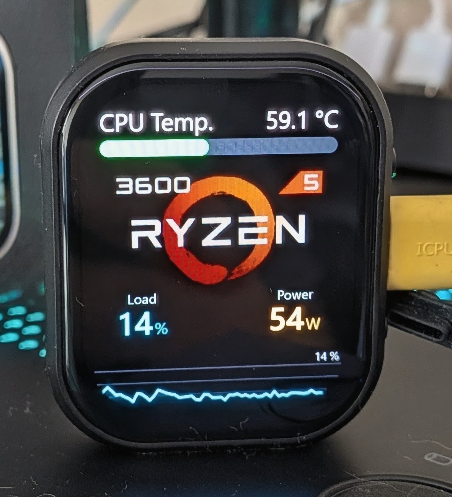</p>


Turn a cheap ESP32 board with an SPI LCD into a USB hardware monitor
for your PC. A Windows app draws HTML widgets (gauges, graphs, clocks, shapes,
images, animated GIFs…) with live sensor data and streams the pixels to the
LCD over USB or, on the CYD, over Wi-Fi. Only the parts of the screen that
change are sent, each rectangle as the smallest of raw, RLE, LZ4 and deflate,
so nothing is lost: the pixels on the LCD are exactly the ones the PC drew.

<p align="center">
  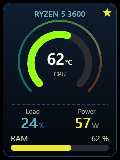
</p>

<p align="center">
  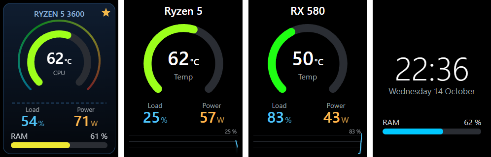
</p>

The app is available in **English** and **Portuguese** (Settings → Language).
The LCD's own "waiting for data" screen follows the same language
([see it](#the-lcd-waiting-screen)).

Created by [joaquim.org](https://joaquim.org) · [MIT License](LICENSE)

## Features

- **Visual editor**: drag, resize and configure components; snapping guides
  to other components and to the screen centre; arrow keys for 1 px moves;
  lock components so they cannot be moved by accident.
- **Data components**: gauge, ring, value, bar, level (segmented or plain,
  horizontal or vertical), graph and trend card (sensor history), sensor list,
  indicator lamp, sensor text, clock, date and text. Text, clock and sensor
  text have font, weight and italic options.
- **Shapes**: line (solid, dashed, dotted), rectangle (rounded corners,
  border, gradient), circle/ellipse, arc/ring (with a colour gradient along
  the arc) and polygon/star.
- **Images**: PNG and JPG (with transparency), animated GIF and WebP, SVG and
  BMP, with fit, opacity, rotation, rounded corners and a pixel-art mode.
- **Zoom to the LCD**: a widget designed for one size is zoomed to fill another
  LCD (Fit, Fill or Automatic) without distorting text or shapes, so the same
  widgets work on boards with different resolutions.
- **Fast and lossless**: every changed rectangle goes out in the smallest of
  raw, RLE, LZ4 and deflate (the ESP32 decodes deflate in its ROM). Deflate sends
  about 27% fewer bytes than LZ4 on a real full-screen GIF and gives 32-36% more
  fps on every link, with a pixel-identical result (see [Speed](#speed)).
- **Wi-Fi link (CYD)**: set the board up once over the cable and then drive
  it over Wi-Fi, about 2-3× faster than the serial cable. Both links stay
  available (see [Wi-Fi](#wi-fi-cyd)).
- **Smooth animations**: GIFs and transitions are limited by the link speed
  (about 0.15 MB/s on the CYD serial cable, 0.3-0.65 MB/s over its Wi-Fi, 0.5 MB/s
  on native USB), so *Settings → Animation smoothness* can send moving areas
  at half the resolution (the board doubles the pixels) and bring back full
  quality when they stop. The AMOLED board also shows each frame at once, with
  no visible refresh.
- **Rotate the LCD** in steps of 90° (*Settings → LCD screen*); the choice is
  kept in the board.
- **Several widgets** that rotate on the LCD, each for its own time, with
  **transitions**: fade, slide and push (4 directions), zoom, wipe, circle or
  random.
- **Sensors** from [LibreHardwareMonitor](https://github.com/LibreHardwareMonitor/LibreHardwareMonitor)
  (CPU, GPU, motherboard, drives, fans…), plus CPU and memory load built into
  the app.
- **Create components with AI**: the app copies a specification to paste into
  ChatGPT, Claude or similar; you paste the answer back and the component is
  added.
- **Share widgets** as self-contained `.lcdwidget` files (layout, custom
  components and images).
- **Visible-area calibration** for panels that only show part of the
  controller (e.g. a 240×280 glass on a 240×320 controller).
- Runs in the tray and can start with Windows.

## Screenshots

**Run**: the widget library with live thumbnails, what is on the LCD now and
the transition between widgets.

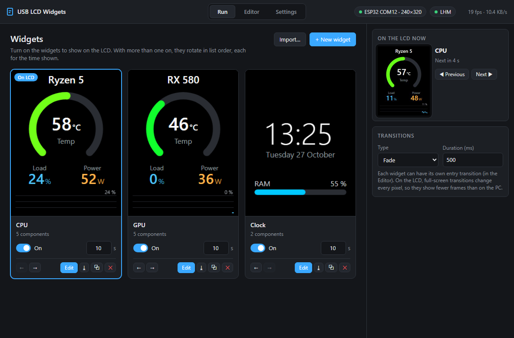

**Editor**: the widget on the left, the live LCD preview in the centre, the
selected component's properties on the right.

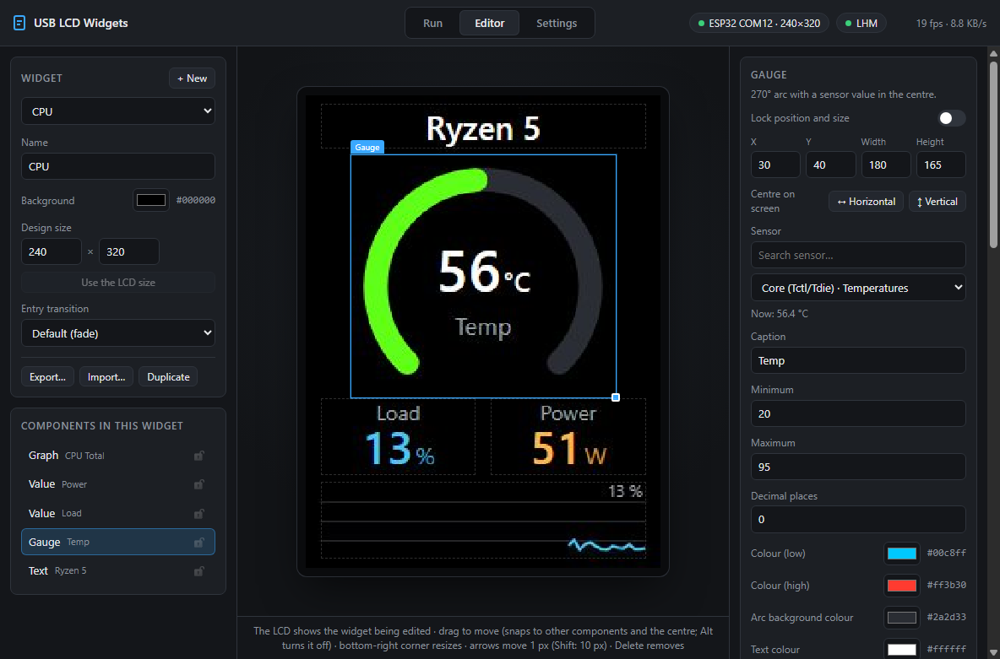

**Component palette**: components, shapes and images.

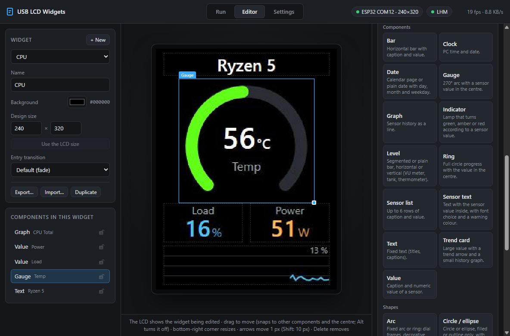

**Settings**: language, sensors, the link to the display (USB cable or Wi-Fi),
rotation and the visible area of the LCD.

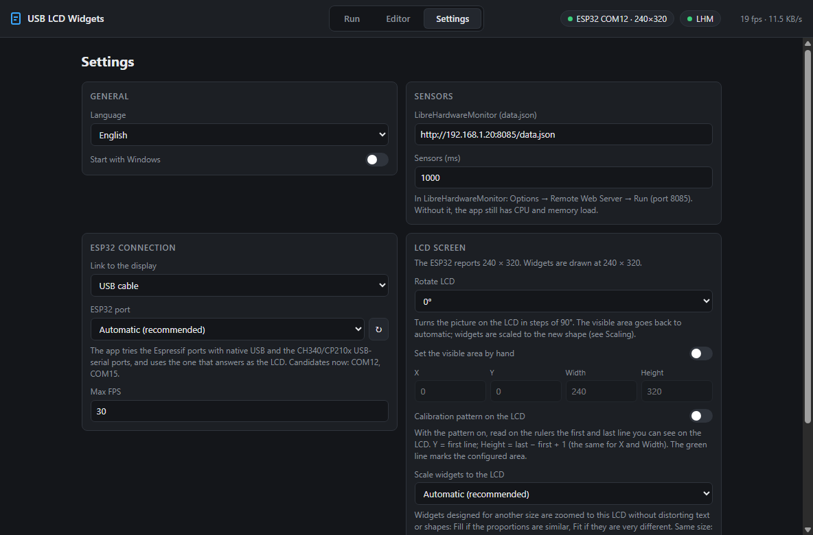

**Wi-Fi**: with *Link to the display* set to *Wi-Fi*, type the network once
(the board keeps it in its flash), and the app shows the board's address and
the signal strength.

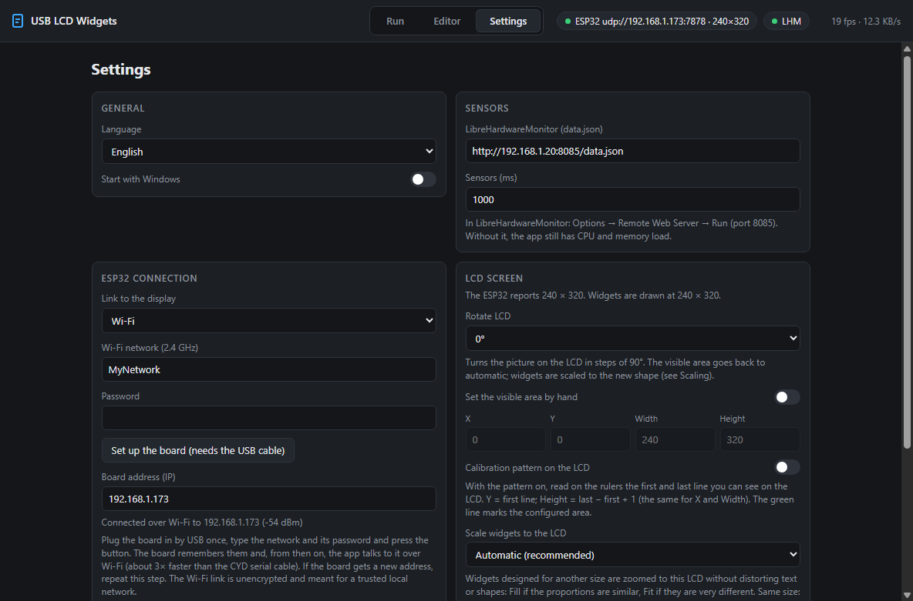

### The LCD waiting screen

When no data arrives (3 s), the LCD shows its own screen: what it is waiting
for, whether the cable side is open, and on the CYD the Wi-Fi state (not set
up, connecting, or connected with its IP address and signal). These are real
captures of the panel, in both languages.

<p align="center">
  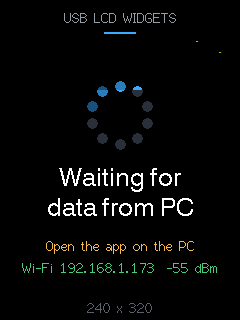
  &nbsp;&nbsp;
  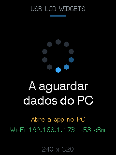
</p>

**Calibration**: the LCD shows rulers so you can read the visible area of the
panel.

<p align="center">
  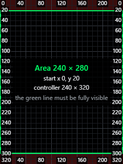
</p>

The same app in Portuguese:

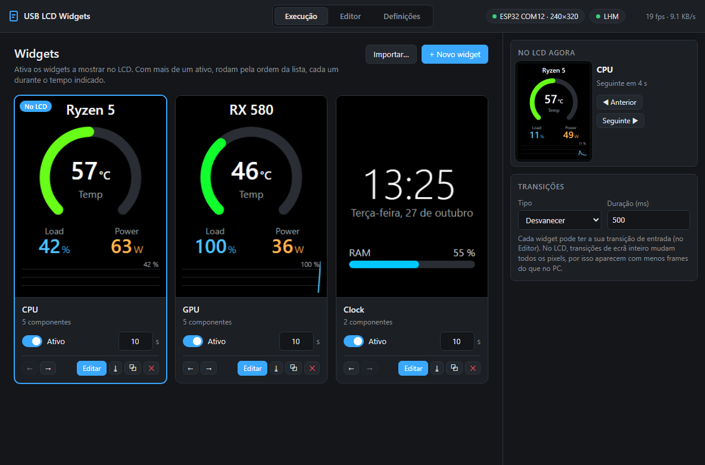

## Hardware

Each board + display is a PlatformIO environment in
[platformio.ini](platformio.ini); the firmware and the app are the same for all
of them. The app reads the LCD size from the board, so other resolutions only
need a new environment.

| Environment | Board | Display | PC link |
|---|---|---|---|
| `lolin_s2_mini` | [LOLIN (WEMOS) S2 Mini](https://www.wemos.cc/en/latest/s2/s2_mini.html) (ESP32-S2) | 240×320 SPI, ST7789 | native USB |
| `cyd28_ili9341` | ESP32 CYD 2.8" (ESP32-2432S028R) | 240×320, ILI9341 | USB-serial chip (CH340/CP210x), 2000000 baud, or Wi-Fi |
| `cyd28_st7789` | the same CYD, ST7789 variant | 240×320, ST7789 | as above |
| `waveshare_amoled_206` | Waveshare ESP32-S3-Touch-AMOLED-2.06 (ESP32-S3R8) | 410×502 AMOLED, CO5300 over QSPI | native USB |

If the CYD colours look wrong (blue/red swapped or inverted), try the other
CYD environment. The CYD's touch screen is not used yet.

The CYD firmware also has the Wi-Fi link (UDP) and, with the S2 Mini, the
deflate decoder; the AMOLED keeps LZ4. See [Speed](#speed) for what each link
delivers.

The AMOLED board uses the [GFX Library for Arduino](https://github.com/moononournation/Arduino_GFX)
instead of TFT_eSPI (pins from Waveshare's official `pin_config.h`). The
CO5300 only accepts windows with even x, y, width and height, so the firmware
tells the app (`align` in the HELLO reply) and the app widens every rectangle,
and the visible area, to even values. Its first flash needs the board in
bootloader mode (hold **BOOT**, press **RESET**); the factory USB port is the
native USB, which this firmware takes over. The touch screen, the power chip
and the other sensors are not used.

To add another board or panel, copy an environment and change the
[TFT_eSPI](https://github.com/Bodmer/TFT_eSPI) driver, size and pin flags. Add
`-D LCD_TRANSPORT_UART=1` if the board has no native USB, or look at
[src/lcd.h](src/lcd.h) to add a display library of your own.

### LOLIN S2 Mini wiring

| LCD | ESP32-S2 GPIO |
|---|---|
| MOSI / SDA | 35 |
| SCLK / SCL | 33 |
| MISO | 36 (not needed by most panels) |
| CS | 37 |
| DC | 39 |
| RST | 18 |
| VCC / GND | 3V3 / GND |

The S2 Mini uses its **native USB**. Boards with USB-Serial-JTAG (ESP32-S3/C3/C6
on their JTAG port) are not supported. Boards with a CH340/CP210x USB-serial
chip use the UART build (`LCD_TRANSPORT_UART`, 2000000 baud) like the CYD; the
app finds them automatically. Other USB-serial adapters can be picked by hand
in **Settings → ESP32 connection**.

The CYD has no flow control on the serial link, so it relies on the app sending
one batch at a time and waiting for the ACK (see [How it works](#how-it-works)).

### Frame compression

Every changed rectangle is sent as the smallest of raw, RLE, LZ4 and (on the CYD and the
S2 Mini) deflate. Deflate is about 25-35% smaller than LZ4 on photographic content such
as GIFs and costs nothing in quality: the pixels are identical. See `CHANGELOG.md` for the
measurements and `app/scripts/check-lcd.js` for the read-back check.

### Wi-Fi (CYD)

The serial cable limits the CYD to about 0.15 MB/s. The CYD firmware can also
talk **over Wi-Fi** (2.4 GHz), which in the same animation test is about 3× faster
(full-screen animation 6.5 → 19.8 fps; the radio varies from run to run, 0.35–0.65 MB/s):

1. Plug the CYD in by USB once and open **Settings → ESP32 connection**.
2. Set **Link to the display** to *Wi-Fi*, type the network name and password and
   press **Set up the board**. The board stores them in its flash (the app never
   does) and the app keeps the board's IP address.
3. From then on the cable is only a power supply: the app talks to the board by
   UDP port 7878. To go back, set the link to *USB cable* (both always work).

Notes: the link is not encrypted or authenticated (meant for a trusted local
network); some routers isolate Wi-Fi clients (guest networks); the app is the
one that connects, so allow it through the Windows firewall if asked. The radio
is only started once a network has been configured. Wi-Fi is in the CYD
firmware only; the S2 Mini and the AMOLED board keep their native USB.

## Getting started

### 1. Flash the firmware

**Prebuilt** (S2 Mini): download `usb-lcd-firmware-esp32s2-<version>.bin` from the
[latest release](https://github.com/joaquimorg/esp32_lcd_pcinfo/releases/latest).
Put the board in bootloader mode (hold **0**, press **RST**, release **0**) and
flash the file at address **0x0**, either from the browser with the
[ESP Tool](https://espressif.github.io/esptool-js/) (Chrome or Edge) or with
esptool:

```
esptool.py --chip esp32s2 --port COMx write_flash 0x0 usb-lcd-firmware-esp32s2-<version>.bin
```

Press **RST** when it finishes.

**From source**: with [PlatformIO](https://platformio.org/) (VS Code extension
or CLI), choosing the environment of your board:

```
pio run -e lolin_s2_mini -t upload
pio run -e cyd28_ili9341 -t upload
```

Without `-e`, PlatformIO uses the default environment (`lolin_s2_mini`).

If the S2 Mini is not detected, put it in bootloader mode as above and upload
again. Once the firmware is running, later uploads work without the buttons.
The CYD uploads through its USB-serial chip without any button.

After flashing, the LCD shows "Waiting for data from PC" (see
[the waiting screen](#the-lcd-waiting-screen)) with a status line for the cable
and, on the CYD, one for Wi-Fi:

| Status | Meaning |
|---|---|
| No USB connection to PC | the cable only gives power, or the PC did not recognise the device (S2 Mini only) |
| Open the app on the PC | USB is connected, but the app does not have the port open (on the CYD it also shows when the cable is unplugged) |
| App connected, no data | the app opened the port but is not sending |
| Wi-Fi not set up | no network has been given to the board yet (CYD) |
| Wi-Fi connecting… | the board is joining the network |
| Wi-Fi 192.168.1.x  -55 dBm | joined: its address and signal strength (green) |
| Wi-Fi: cannot join network | wrong password, or a 5 GHz-only network (red) |

### 2. Install LibreHardwareMonitor (optional, for CPU/GPU sensors)

1. Download and run [LibreHardwareMonitor](https://github.com/LibreHardwareMonitor/LibreHardwareMonitor/releases)
   (as administrator, to read all sensors).
2. **Options → Remote Web Server → Run**. The default port is 8085.
3. In the app, **Settings → Sensors → LibreHardwareMonitor** should be
   `http://localhost:8085/data.json` (or the IP of the PC running it).

Without it, the app still offers CPU and memory load and the clock.

### 3. Run the app

Download the installer or the portable `.exe` from the
[latest release](https://github.com/joaquimorg/esp32_lcd_pcinfo/releases/latest),
or build it yourself (Node.js; tested with 22):

```
cd app
npm install
npm start          # run from source
npm run dist       # build app/dist/USB-LCD-Widgets-Setup-<version>.exe and the portable .exe
```

The app finds the ESP32 by itself (Espressif VID and a HELLO handshake). With
more than one board, pick the port in **Settings → ESP32 connection**. To use
the Wi-Fi link instead of the cable, see [Wi-Fi](#wi-fi-cyd).

The executables are not signed, so Windows SmartScreen may warn on the first
run (**More info → Run anyway**). Closing the window keeps the app in the tray
and the LCD updating; use **Quit** in the tray menu to exit.

Settings are stored in `%APPDATA%\usb-lcd-widgets\config.json`.

## Using the app

**Run**
- Turn widgets on or off and set how long each one stays on the LCD. The
  arrows change the order. Clicking the thumbnail of an active widget shows it
  on the LCD right away; **Previous**/**Next** step through them.
- **Transitions**: the transition between widgets and its duration.

**Editor**
- While you edit, the LCD shows the widget being edited and the rotation is
  paused.
- Drag components to move them; the bottom-right corner resizes. Edges and
  centres snap to other components and to the screen (magenta guides: other
  components; dashed yellow: screen centre). Hold **Alt** to move freely.
- Arrow keys move 1 px (Shift: 10 px); **Delete** removes the component.
- Adding an image asks for the file and sizes the component to the image.
- Each widget can have its own **entry transition**.
- **Export…** saves the widget as a `.lcdwidget` file; **Import…** opens one.

**Settings**
- **General**: language and start with Windows.
- **Sensors**: LibreHardwareMonitor URL and how often sensors are read.
- **ESP32 connection**: **Link to the display** (USB cable, or Wi-Fi with the
  network, password, **Set up the board** and the board's address), the port
  (automatic by default) and maximum FPS.
- **LCD screen**: **Rotate LCD** (0°, 90°, 180°, 270°), **Scale widgets to the
  LCD** (how widgets designed for another size are zoomed; Automatic by default)
  and **Animation smoothness**. If your panel only shows part of the controller,
  turn on the calibration pattern, read the first and last visible line on the
  rulers, and enter the visible area by hand.

## Custom components

A component is a folder with a `widget.html` and a manifest. Put your own in
`%APPDATA%\usb-lcd-widgets\widgets` (**Editor → Add component → Folder**) and
press **Reload**.

`manifest.json`:

```json
{
  "name": "Temperature",
  "description": "Shows a temperature",
  "category": "component",
  "size": { "w": 120, "h": 60 },
  "properties": [
    { "key": "sensor", "type": "sensor", "label": "Sensor" },
    { "key": "color", "type": "color", "label": "Colour", "default": "#ffffff" }
  ],
  "i18n": {
    "pt": { "name": "Temperatura", "properties": { "color": { "label": "Cor" } } }
  }
}
```

Property types: `text`, `number` (with `min`/`max`), `color`, `boolean`,
`select` (with `options`, and optional `optionLabels` for display text),
`sensor` and `file` (an image). `category` picks the palette group:
`component`, `shape` or `image`. `i18n` is optional and holds translations;
the stored values never change with the language.

`widget.html`:

```html
<script src="../_sdk/widget-sdk.js"></script>
<div id="v"></div>
<script>
  Widget.onUpdate((props, info) => {
    document.getElementById('v').textContent = Widget.format(props.sensor, 1);
  });
</script>
```

Sensor properties arrive as `{ id, name, hardware, group, type, value, unit,
min, max, history }`. `info` has the component size and the app language. The
SDK ([widget-sdk.js](app/widgets/_sdk/widget-sdk.js)) also has helpers to
format values, map them to 0..1 and blend colours. The built-in components in
[app/widgets](app/widgets) are good examples. The manifest can also be
embedded in the HTML, which is the single-file format the AI uses
([specification](app/docs/widget-ai-spec.en.md)).

Each component runs in its own iframe with a transparent background. Every
pixel that changes is sent over USB, so avoid continuous animations over large
areas.

## How it works

```
Windows app (Electron)                          ESP32 + LCD
┌───────────────────────────────┐  USB CDC / serial   ┌──────────────────────┐
│ offscreen Chromium page        │  / Wi-Fi (UDP)      │ receive ring          │
│  └ one iframe per component    │  ───────────────▶   │  └ raw/RLE/LZ4/deflate │
│ frame diff → dirty rectangles  │  rectangles in      │     decode             │
│ RGB565 + best of raw/RLE/LZ4/  │  batches            │  └ SPI to the LCD      │
│ deflate per rectangle          │  ◀───────────────   │ ACK per batch          │
└───────────────────────────────┘        ACK           └──────────────────────┘
```

- The app renders the LCD page offscreen at the panel resolution, converts
  each frame to RGB565 and compares it with the previous one in 16×16 tiles.
  Neighbouring changed tiles are merged and trimmed to the exact changed area,
  so a widget changing in the middle of the screen does not resend whole lines.
  Each rectangle goes out as raw, RLE, LZ4 or deflate (if the firmware
  supports them), whichever is smaller; deflate only when it saves more than
  10% over LZ4, because it is slower to decode. LZ4 is about 2.4× smaller than
  RLE on real LCD frames and deflate about 27% smaller than LZ4 on photographic
  content such as GIFs. The ESP32 decodes deflate with the `tinfl` routine that
  is already in its ROM (no extra flash, 11 KB of RAM).
- Over the USB cable and the serial cable, frames are sent in batches of up to
  16 KB, one at a time: the next batch only goes after the ESP32 acknowledges the
  previous one. This keeps the ESP32's 32 KB receive buffer from filling up,
  which on the ESP32-S2 could stall the USB link under continuous traffic (for
  example with animated GIFs). Over Wi-Fi the transport has its own flow
  control, so the app keeps three batches of up to 24 KB in flight.
- **Wi-Fi transport**: a reliable byte stream over UDP (sequence numbers,
  selective acknowledgements, fast retransmission, window tied to the board's
  32 KB ring), because the Arduino core's TCP window is fixed at 5760 bytes and
  limits TCP to ~0.3 MB/s. The board's `AsyncUDP` receiver queues 64 datagrams
  (the lwip `recvfrom` queue only holds 6 and overflowed with the bursts the
  radio delivers) and acknowledgements are coalesced, because each send costs
  ~1.8 ms. The format is in [src/protocol.h](src/protocol.h); the other end is
  [app/src/main/udp-link.js](app/src/main/udp-link.js).
- Without data for 3 s the ESP32 shows its waiting screen; the app sends a
  keep-alive every second.
- The protocol is documented in [src/protocol.h](src/protocol.h).

### Speed

What each link delivers on the same board and the same test (a real 150-frame,
full-screen animated GIF, 240×320, full quality, frames sent as fast as the link
allows):

| Board and link | Throughput | LZ4 only | With deflate |
|---|---|---|---|
| CYD, serial cable (2 Mbaud) | ~0.15 MB/s | 2.2 fps | 3.0 fps |
| CYD, Wi-Fi | 0.3-0.65 MB/s, varies | 4.9 fps | 6.6 fps |
| S2 Mini, native USB | ~0.4 MB/s | 6.3 fps | 8.2 fps |

Small updates (gauges, text, a graph) cost a few KB and run at the maximum FPS
set in the app on every link; the table is the worst case, a screen whose every
pixel changes. Things measured that do **not** help, so they are not in the
firmware: a 40 MHz Wi-Fi channel and maximum transmit power (the CYD's radio has
5-60 ms of jitter and is the limit), and sending only the difference to the
previous frame (`RECT_FLAG_XOR`, kept but off: it needs a copy of the screen in
the board's RAM, which on the CYD only fits 130-180 of its 320 rows with Wi-Fi on,
and it only pays when consecutive frames sent are close in time, which these
links are too slow for: 2-5% measured).

The Wi-Fi radio varies from run to run, so compare numbers measured
back to back. The scripts used are in [app/scripts](app/scripts):

| Script | What it does |
|---|---|
| `bench-udp.js <ip>` | throughput of the Wi-Fi transport alone (sink, raw, lz4, dirty) |
| `e2e-wifi.js <ip>` or `--serial COMx` | the real app pipeline (device + frame sender) with synthetic frames or `--frames file.u16`; `NOZ=1` turns deflate off for an A/B |
| `check-lcd.js <ip or COMx> <frames.u16>` | sends frames and proves the LCD shows exactly the last one, by reading the panel back and comparing CRC32 (firmware built with `-D LCD_CHECK`) |
| `capture-lcd.js COMx out.png` | exact capture of the LCD, used for the waiting-screen images (also needs `LCD_CHECK`) |

### Recovery

Closing the USB port in the middle of a transfer can leave the ESP32-S2's USB
stuck. The firmware restarts itself if a reply cannot be sent for 1 s, or if
the port is open and nothing arrives for 10 s. The app asks for a restart
(opening the port at 2400 baud) if the board stops answering. In all cases the
LCD comes back after about 10 s. The app log shows why the ESP32 last
restarted. Over Wi-Fi there is nothing to restart: if the board stops
answering for 3 s the app opens a new session (a new random id, so stale
datagrams are ignored) and redraws the whole screen.

## Project structure

| Path | Contents |
|---|---|
| [src/](src) | ESP32 firmware (`main.cpp`, `protocol.h`, `wifi_link.h` for the Wi-Fi transport) |
| [platformio.ini](platformio.ini) | One environment per board/LCD: driver, pins and PC link |
| [src/lcd.h](src/lcd.h) | Display layer: TFT_eSPI (SPI LCDs) or GFX Library for Arduino (QSPI AMOLED) |
| [lib/TFT_eSPI](lib/TFT_eSPI) | LCD library |
| [app/src/main](app/src/main) | App main process: USB, serial and Wi-Fi (`udp-link.js`) links, frame encoding, sensors, settings, widget rotation, `.lcdwidget` files |
| [app/src/display](app/src/display) | Offscreen page that composes the LCD and runs the transitions |
| [app/src/control](app/src/control) | App window: Run and Editor views |
| [app/src/i18n.js](app/src/i18n.js) | English and Portuguese texts |
| [app/widgets](app/widgets) | Built-in components and the SDK |
| [app/test](app/test) | Tests (`npm test`) |
| [app/scripts](app/scripts) | Benchmarks and checks: `bench-udp.js`, `e2e-wifi.js`, `check-lcd.js`, `capture-lcd.js` |
| [tools/usb_display_bench.py](tools/usb_display_bench.py) | USB/serial throughput benchmark for the firmware, without the app |

## Development

```
cd app
npm test                                   # unit tests
npm start -- --screenshot=out --profile=tmp # captures the app and LCD images into "out" and quits
```

With the environment variable `LCD_DEBUG=1` (PowerShell: `$env:LCD_DEBUG=1; npm start`)
the app prints, every second, the frames per second and KB/s sent to the LCD,
the KB per format (raw, RLE, LZ4, deflate, fill), the rectangles, and the pixels sent
against the pixels that really changed (the closer, the less is wasted).

To add a language, add a table to [app/src/i18n.js](app/src/i18n.js), an
`i18n.<lang>` section to the built-in manifests, and the waiting-screen texts
to the firmware (`LcdLanguage` in `protocol.h`).

See [CHANGELOG.md](CHANGELOG.md) for the version history.

## License

Copyright © 2026 [joaquim.org](https://joaquim.org). Released under the
[MIT License](LICENSE).

[TFT_eSPI](lib/TFT_eSPI) is a third-party library by Bodmer and keeps its own
licence ([license.txt](lib/TFT_eSPI/license.txt)).
